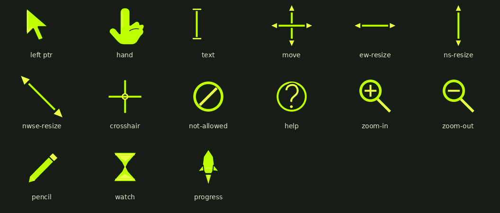

# ZeroMouse Neon Launch

**A high-visibility XCursor theme for people with visual impairments and low
vision.** Designed from lived experience with visual impairment, it uses neon
lime to yellow-green artwork, dark outlines, distinct shapes, and large cursor
sizes.



[Hourglass animation](preview/hourglass-animation.gif) · [Rocket launch animation](preview/rocket-animation.gif) · [Deutsche README](README.md)

## Accessibility features

- Ten cursor sizes from 24 to 512 pixels, including 36 and 72 pixels for common
  KDE size choices.
- Bright yellow-green fills with dark outlines for visibility on light and dark
  surfaces.
- Distinct symbols for pointer, text, hand, move, resize, help, zoom, forbidden,
  and other common cursor roles.
- An animated hourglass for waiting and a rocket for progress feedback.
- Each cursor size is rendered independently with antialiased edges, instead of
  enlarging a small bitmap.

Color and size can be adjusted in supported desktop environments. Visibility
depends on the display, scaling, background, and each person's vision.

## Linux support and packages

The theme uses the widely supported XCursor format. Cursor files contain
multiple resolutions; files in `zeromouse/cursors/` use cursor role names such
as `left_ptr` and `watch` without extensions. PNG and GIF files in `preview/`
are separate image previews.

The **Build Linux packages** workflow can be started manually from GitHub
Actions. Before packaging, it validates file headers, all ten sizes, hotspots,
animation frames, and alias targets. It produces:

| Linux family | Package |
| --- | --- |
| Arch Linux, CachyOS, and Arch-based systems | pacman `.pkg.tar.zst` |
| Debian and Ubuntu | `.deb` |
| Fedora and RPM-based systems | `.rpm` |
| Other Linux distributions | portable XCursor `.tar.gz` archive |

Wayland support depends on the desktop environment and compositor. KDE Plasma
and other XCursor-compatible environments can select the theme directly.

## Build packages on GitHub

1. Open the repository and choose **Actions → Build Linux packages → Run
   workflow**.
2. The run builds all four packages, calculates SHA-256 checksums, and makes a
   combined bundle available under **Artifacts**.
3. Optionally enable **Create a GitHub Release** to attach the packages to a
   release tagged `v<VERSION>`. Existing tags are never overwritten.

[VERSION](VERSION) is the single source for the project version. Update it
before a release and reset Arch's `pkgrel` in `PKGBUILD` to `1`. Increase only
`pkgrel` for Arch package changes that do not change the project version.

## Install on Arch Linux

```sh
./install.sh
```

Or build and install manually:

```sh
makepkg -f
sudo pacman -U "$(makepkg --packagelist | tail -n 1)"
```

Then open **System Settings → Colors & Themes → Cursors**, select **ZeroMouse
Neon Launch**, and choose a size. Uninstall with `./uninstall.sh`.

## Debian, Fedora, and other systems

Install a `.deb` with `sudo apt install ./zeromouse-cursor-theme_*.deb` or an RPM
with `sudo dnf install --nogpgcheck ./zeromouse-cursor-theme-*.rpm`. The
published RPM is unsigned; verify its SHA-256 checksum from `SHA256SUMS` before
installing. The portable archive
contains the theme and instructions. For a system-wide install, copy `zeromouse`
to `/usr/share/icons/ZeroMouse`; for a user-only install, copy it to
`~/.local/share/icons/ZeroMouse`.

## Development and license

All package builders read `VERSION`. `build.py` creates XCursor files and
`preview.py` renders the README previews; both require Python 3 and the
dependencies in [requirements.txt](requirements.txt).

Licensed under the **GNU Affero General Public License v3.0 or later**
(AGPL-3.0-or-later). See [LICENSE](LICENSE) and [CONTRIBUTING.md](CONTRIBUTING.md).
