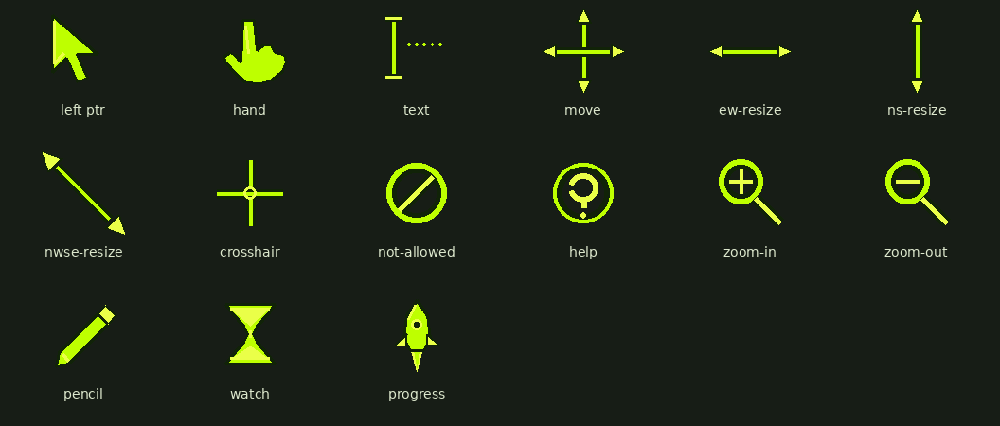

# ZeroMouse Neon Launch

**A high-visibility XCursor theme for people with visual impairments and low
vision.** Designed from lived experience with visual impairment, it uses neon
lime to yellow-green artwork, dark outlines, distinct shapes, and large cursor
sizes.



[Hourglass animation](preview/hourglass-animation.gif) · [Rocket launch animation](preview/rocket-animation.gif)

## Accessibility features

- Ten cursor sizes from 24 to 512 pixels, including 36 and 72 pixels for common
  KDE size choices.
- Bright yellow-green fills with dark outlines for visibility on light and dark
  surfaces.
- Distinct symbols for pointer, text, hand, move, resize, help, zoom, forbidden,
  and other common cursor roles.
- An animated hourglass for waiting and a rocket for progress feedback.
- Each cursor size is rendered independently with antialiased edges, instead of
  enlarging a small bitmap.

Color and size can be adjusted in supported desktop environments. Visibility
depends on the display, scaling, background, and each person's vision.

## Linux and Windows support

The theme uses the widely supported XCursor format. Cursor files contain
multiple resolutions; files in `zeromouse/cursors/` use cursor role names such
as `left_ptr` and `watch` without extensions. PNG and GIF files in `preview/`
are separate image previews.

The **Build Linux and Windows packages** workflow can be started manually from
GitHub Actions. It validates XCursor headers, image sizes, hotspots, animation
frames, aliases, and the Windows CUR/ANI output. It produces:

| Linux family | Package |
| --- | --- |
| Arch Linux, CachyOS, and Arch-based systems | pacman `.pkg.tar.zst` |
| Debian and Ubuntu | `.deb` |
| Fedora and RPM-based systems | `.rpm` |
| Other Linux distributions | portable XCursor `.tar.gz` archive |
| Windows 10 and 11 | per-user installer `.exe` |

Wayland support depends on the desktop environment and compositor. KDE Plasma
and other XCursor-compatible environments can select the theme directly.

## Build packages on GitHub

1. Open the repository and choose **Actions → Build Linux and Windows packages
   → Run workflow**.
2. The run builds Linux packages and the Windows installer, calculates SHA-256
   checksums, and makes a combined bundle available under **Artifacts**.
3. **Create a versioned GitHub Release** is enabled by default. Leave it enabled
   to publish all packages under the tag `v<VERSION>`; disable it to build
   downloadable workflow artifacts without publishing a release. Existing
   releases and tags are never overwritten.

[VERSION](VERSION) is the single source for the project version. Update it
before a release and reset Arch's `pkgrel` in `PKGBUILD` to `1`. Increase only
`pkgrel` for Arch package changes that do not change the project version.

## Install on Arch Linux

```sh
./install.sh
```

Or build and install manually:

```sh
makepkg -f
sudo pacman -U "$(makepkg --packagelist | tail -n 1)"
```

Then open **System Settings → Colors & Themes → Cursors**, select **ZeroMouse
Neon Launch**, and choose a size. Uninstall with `./uninstall.sh`.

## Windows 10 and 11

Download and run `ZeroMouse-Setup-<version>.exe` from the GitHub Release. The
installer works for the current user and does not require administrator rights.
It applies the pointer, text, hand, help, move, resize, crosshair, forbidden,
and pen cursors. Zoom cursors are included for manual use. Windows uses the
animated hourglass when busy and the animated rocket when an application starts. The uninstaller
restores the cursor settings that were active before installation.

Windows `.cur` and `.ani` files store dimensions in one-byte fields, where the
largest representable image size is 256 × 256 pixels. The Windows theme
therefore includes the same artwork at 24, 32, 36, 48, 64, 72, 96, 128, and 256
pixels. Windows 10 and 11 can adjust the displayed pointer size under
**Settings → Accessibility → Mouse pointer and touch**; 512-pixel XCursor images
remain available on Linux.

The installer is not code-signed. Windows may show its standard publisher
warning before installation.

## Debian, Fedora, and other systems

Install a `.deb` with `sudo apt install ./zeromouse-cursor-theme_*.deb` or an RPM
with `sudo dnf install --nogpgcheck ./zeromouse-cursor-theme-*.rpm`. The
published RPM is unsigned; verify its SHA-256 checksum from `SHA256SUMS` before
installing. The portable archive
contains the theme and instructions. For a system-wide install, copy `zeromouse`
to `/usr/share/icons/ZeroMouse`; for a user-only install, copy it to
`~/.local/share/icons/ZeroMouse`.

## Development and license

All package builders read `VERSION`. `build.py` creates XCursor files;
`windows/build-windows-cursors.py` creates Windows `.cur` and `.ani` files from
the same artwork. Both require Python 3 and the dependencies in
[requirements.txt](requirements.txt). The Windows installer is compiled with
Inno Setup on a Windows runner.

Licensed under the **GNU Affero General Public License v3.0 or later**
(AGPL-3.0-or-later). See [LICENSE](LICENSE) and [CONTRIBUTING.md](CONTRIBUTING.md).
